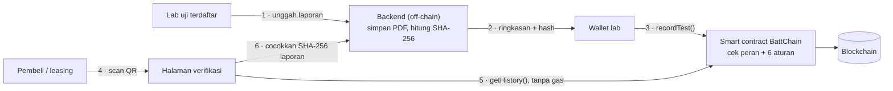

# BattChain

**Riwayat kesehatan baterai EV bekas yang bisa dicek siapa saja dan tidak bisa disembunyikan.**

Proyek MVP mata kuliah ET-4133 Infrastruktur Blockchain, Teknik Elektro ITB, semester 2026/2027.

Angka *state of health* (SOH) yang tampil di layar mobil listrik berasal dari BMS pabrikan, dan riset terbaru menunjukkan angka itu sering meleset dari kapasitas sebenarnya. Hasil uji dari lab independen tersebar di sistem masing-masing, sehingga penjual bisa menunjukkan hasil yang paling bagus saja. BattChain menyatukan semua hasil uji dari banyak lab ke satu riwayat per baterai. Hanya lab terdaftar yang boleh menulis, catatan tidak bisa dihapus, dan siapa pun bisa membacanya.

## Cara kerja



| Peran | Siapa | Boleh apa |
|---|---|---|
| `DEFAULT_ADMIN_ROLE` | konsorsium (akun yang men-deploy) | memberi/mencabut peran, mengatur toleransi SOH |
| `REGISTRAR_ROLE` | pabrikan / importir | mendaftarkan baterai baru |
| `LAB_ROLE` | lab uji terdaftar | mencatat hasil uji dan refurbish |
| siapa saja | pembeli, leasing, asuransi | membaca riwayat |

## Status progress

| Minggu (roadmap brief) | Target | Status |
|---|---|---|
| 1 · Remix & Solidity, deploy kontrak awal | kontrak dengan peran + `registerBattery` | Selesai |
| 2 · Fungsi inti, access control, tes dasar | `recordTest`, `recordRefurbish`, `getHistory`, 6 aturan, tes | Selesai: 25 tes lolos, coverage 100% |
| 3 · UI sederhana, tes positif & negatif | halaman verifikasi pembaca `getHistory` + cek hash laporan | Prototipe jalan di node lokal |
| 4 · Stabilisasi, deck teknis, gladi demo | deploy testnet, demo live | Berikutnya |

## Isi repo

```
contracts/BattChain.sol      smart contract (Solidity 0.8.28, OpenZeppelin AccessControl 5.x)
test/BattChain.test.js       25 tes otomatis: 6 aturan, peran, event, skenario end-to-end
scripts/demo.js              skenario demo lengkap (diterima/ditolak + gas)
scripts/deploy.js            deploy + beri peran awal (localhost / Sepolia)
web/index.html               halaman verifikasi: cari nomor seri pack, lihat riwayat, cocokkan laporan, QR
contoh-laporan/              3 laporan uji fiktif; SHA-256-nya yang dicatat di chain saat demo
docs/demo-remix.md           langkah demo di Remix VM, lengkap dengan input
```

## Menjalankan

Butuh [Node.js](https://nodejs.org) 20 atau lebih baru.

```bash
npm install
npm test            # 25 tes
npm run coverage    # laporan coverage (folder coverage/)
npm run gas         # tes + tabel gas per fungsi
npm run demo        # skenario demo di jaringan sementara
```

### Halaman verifikasi (dua terminal)

```bash
# terminal 1
npm run node
# terminal 2
npm run demo:local
```

Skrip demo mencetak alamat kontrak dan tautan seperti `web/index.html?address=0x5FbD…&pack=PACK-001`. Buka file itu di browser. Untuk mencoba cek keaslian laporan, pilih salah satu file di `contoh-laporan/` (hasilnya **cocok**), lalu coba lagi setelah mengubah satu angka di file itu (hasilnya **tidak cocok**).

### Demo di Remix

Lihat [docs/demo-remix.md](docs/demo-remix.md). Kontrak hanya butuh satu file dan impor OpenZeppelin, yang diambil otomatis oleh Remix.

## Enam aturan validasi di kontrak

| # | Aturan | Kalau dilanggar |
|---|---|---|
| 1 | Hanya peran yang tepat yang boleh menulis | `AccessControlUnauthorizedAccount` |
| 2 | Baterai harus terdaftar dan tidak boleh didaftarkan dua kali | `NotRegistered`, `AlreadyRegistered` |
| 3 | SOH harus 0,01–100,00% (1–10.000 bps) | `SohOutOfRange` |
| 4 | Odometer tidak boleh mundur | `OdometerRollback(last, given)` |
| 5 | Jumlah siklus tidak boleh berkurang | `CycleRollback(last, given)` |
| 6 | SOH tidak boleh naik lebih dari toleransi (bawaan 3 poin) kecuali dicatat sebagai refurbish | `SohIncreaseTooLarge(last, given)` |

## Data on-chain vs off-chain

- **On-chain:** ID baterai (`keccak256` nomor seri pack), ringkasan uji (SOH, odometer, siklus, waktu, alamat lab, refurbish), dan SHA-256 laporan.
- **Off-chain:** file laporan PDF, kurva tegangan, dan log BMS. Cukup hash-nya yang dicatat; siapa pun bisa mencocokkan.
- **Tidak disimpan sama sekali:** identitas pemilik, alamat, plat nomor (mengurangi risiko UU 27/2022 tentang PDP), harga dan pembayaran.

## Hasil pengujian

- 25 tes lolos. Coverage 100% statement, branch, fungsi, dan baris.
- Gas transaksi (Hardhat, optimizer 200 runs, termasuk biaya dasar 21.000): deploy ±898 ribu, `registerBattery` ±48,8 ribu, `recordTest` ±102–122 ribu, `recordRefurbish` ±128 ribu, `getHistory` gratis (hanya baca).

## Keterbatasan

- Blockchain tidak mencegah lab memasukkan angka palsu. Mitigasinya akreditasi lab, hash laporan, dan aturan kewajaran di kontrak.
- Toleransi kenaikan SOH 3 poin masih asumsi tim untuk beda alat ukur, dan bisa diubah admin.
- Halaman verifikasi belum di-hosting; saat ini membaca node lokal atau RPC yang diisi manual.

## Tim

| Nama | NIM | Fokus |
|---|---|---|
| Rafi Ahmad Fabiannaufal | 13223008 | riset & deck |
| Faiz Arkan Waskitazaman | 13223109 | validasi & pengujian |
| Razan Ar Rizqullah | 18120041 | arsitektur & halaman verifikasi |
| M. Akhdan Ismail Pulungan | 18122053 | smart contract & demo |

## Lisensi

MIT
